# Splunk SOC Lab – SSH Login Monitoring and Brute-Force Detection

## 1. Introduction

This project is a beginner SOC lab built with Splunk.

The main goal was to learn how to collect security logs, search the logs with SPL, investigate failed SSH login attempts, identify suspicious login patterns, detect a brute-force pattern, and create a simple SOC dashboard.

The logs used in this lab contain SSH login events with information such as:

* Source IP address
* Username
* Login status
* Service
* Action
* Time of the event

The dataset contains both successful and failed login attempts.

# 2. Starting Splunk

I started the Splunk service on my Ubuntu machine before doing any investigation.

I first checked that Splunk was available and then confirmed that the Splunk service was running correctly.

The purpose of this step was to make sure Splunk was ready to receive and search security logs.

Splunk started.
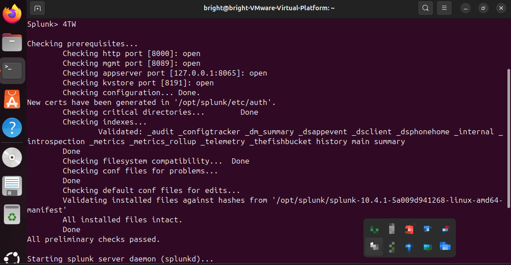

Splunk running.
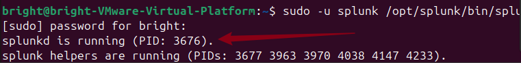


# 3. Opening the Splunk Web Interface

After starting Splunk, I opened the Splunk Web Interface from my browser.

The web interface is where I performed the searches, investigated the logs, and created the dashboard.

Splunk provides a search area where I can enter SPL commands and see the security events returned from the index.
Splunk web interface
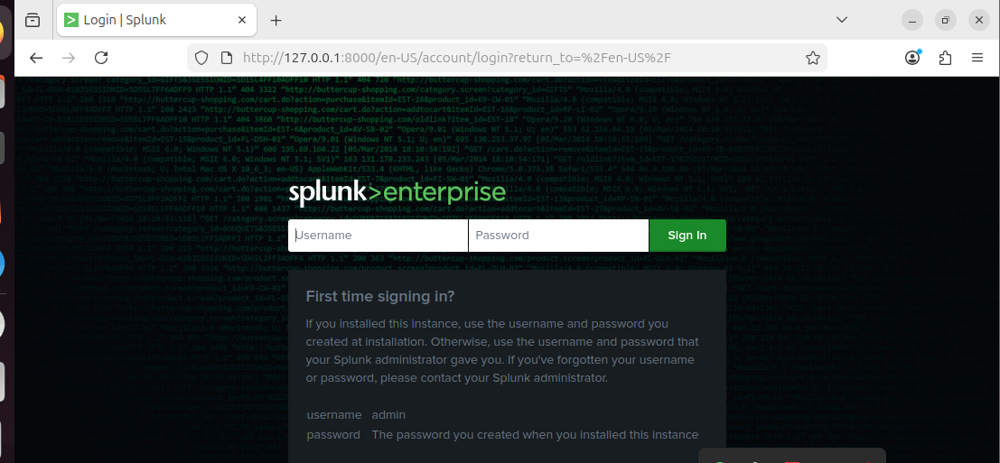


# 4. Checking Existing Events

Before creating the SOC investigation, I checked the events that were already available in Splunk.

The purpose of this was to understand what type of information was already inside Splunk and to make sure I was working with actual security events.

I checked the existing events and confirmed that the logs contained login activity.

Splunk existing events
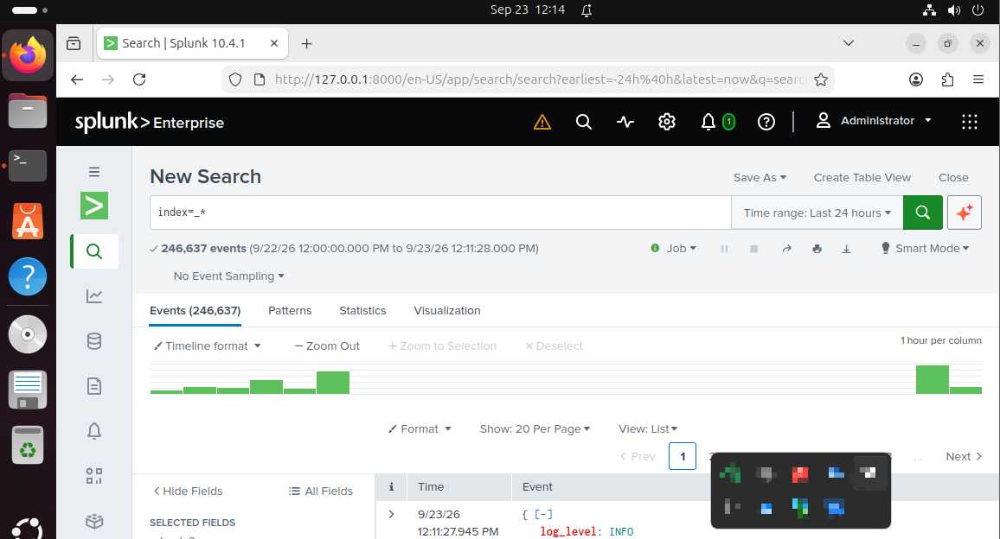

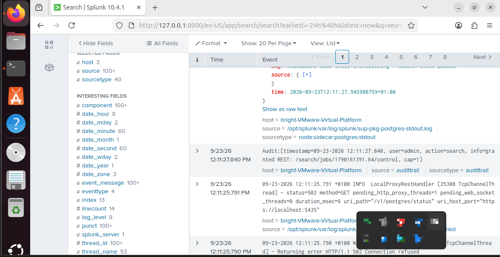


# 5. Creating the SOC Lab Index

I created an index called:

text
soc_lab

An index in Splunk is where data is stored and organized so that it can be searched.

I used a separate index for this project so that the SOC investigation would be easier to manage.

I also checked the security log file that I planned to upload.

security index configuration
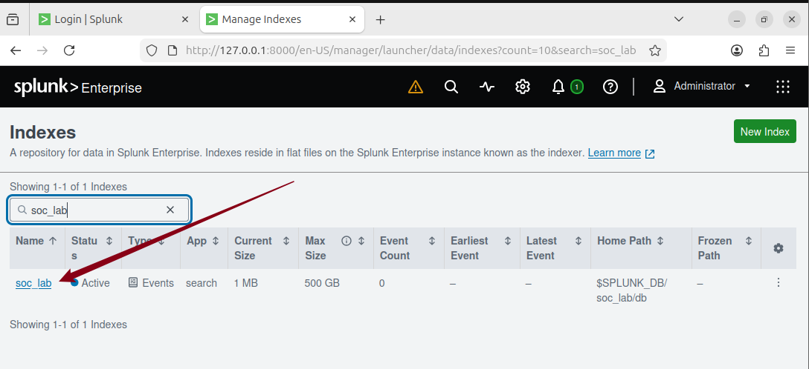


This shows the security log file that was used for the project.

Security events log


The log file contained login events that Splunk could later search and analyze.
 


# 6. Adding the Security Logs to Splunk

I added the security log file to Splunk so that I could investigate the login activity.

During the upload process, I selected the `soc_lab` index.

I also used the following source type:


soc : security

The source type helps Splunk identify and organize the type of data being collected.

Here, the log file being added to Splunk.
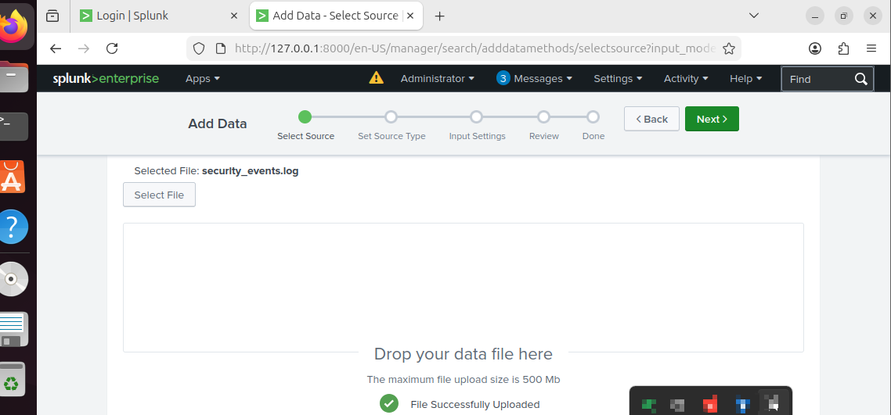

This shows that the `soc_lab` index was selected.

index soc lab
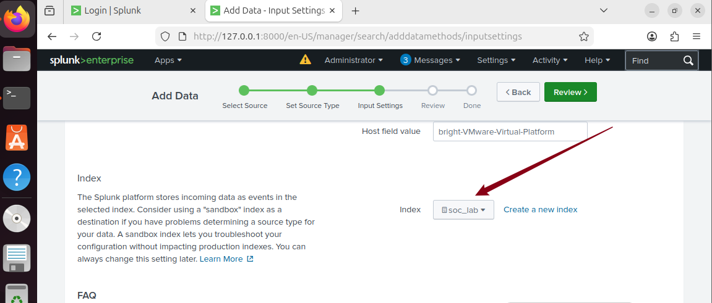


This shows the data configuration before completing the upload.

Data configuration review
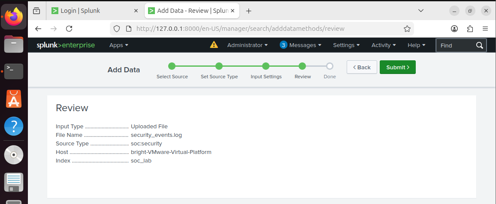

This confirms that the security log was successfully uploaded.

Upload success
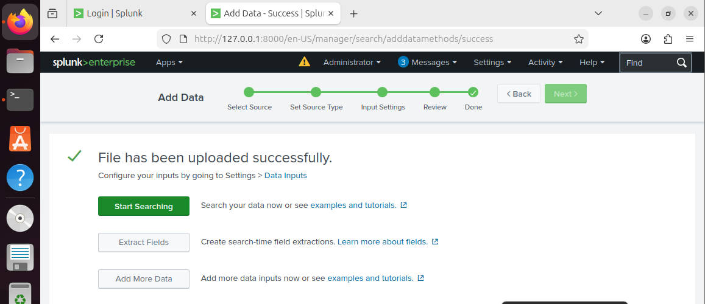

After this step, the login events were available for investigation.


# 7. Learning Basic SPL

SPL means **Search Processing Language**.

It is the language used by Splunk to search and analyze data.

I started with simple searches before moving to more advanced detection queries.

I first searched the `soc_lab` index.

```spl
index=soc_lab
```

This tells Splunk:

> Search for events that are stored inside the `soc_lab` index.

I then added filters to narrow down the events.

Basic spl filter
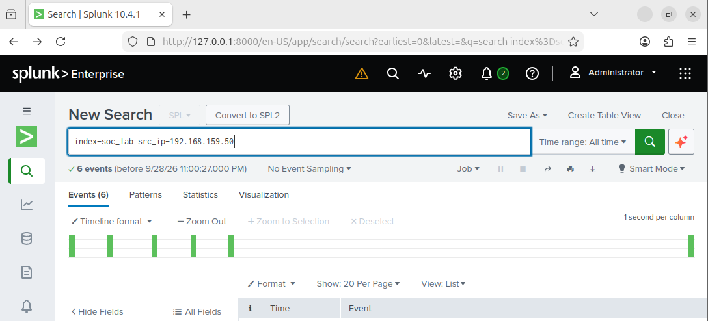

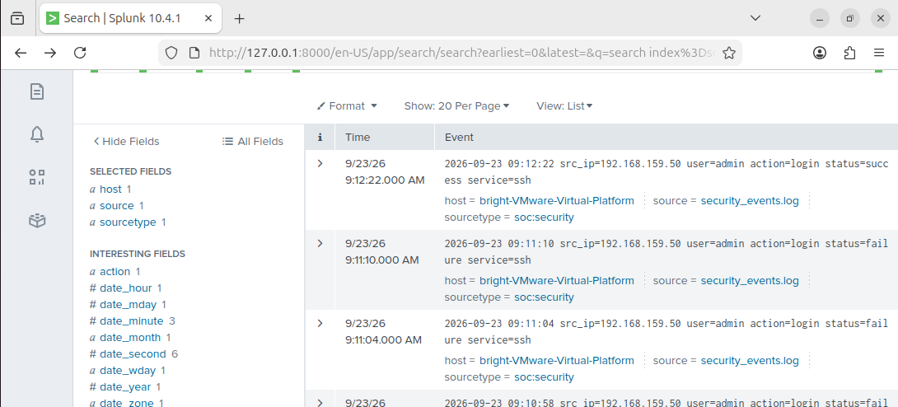

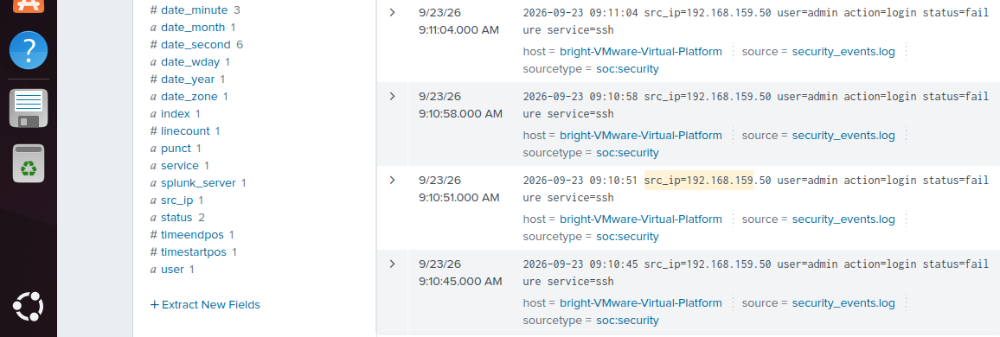

These searches helped me understand how Splunk filters events before moving into more detailed investigation.


# 8. Counting Login Events

After learning the basic search syntax, I wanted to understand where the login events were coming from.

## 8.1 Counting events by source IP

I used:

```spl
index=soc_lab
| stats count by src_ip
```

The first part searches the `soc_lab` index.

The `stats count by src_ip` part groups the events according to their source IP address and counts how many events came from each IP.

This helps an analyst see which IP addresses generated the login activity.

The result showed that:

* `192.168.159.50` generated 6 events
* `192.168.159.20` generated 1 event
* `192.168.159.25` generated 1 event

The important observation was that `192.168.159.50` generated most of the activity.

SPL count by IP
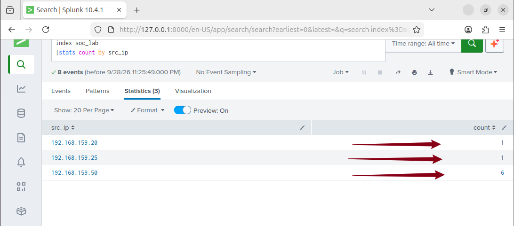


## 8.2 Counting events by login status

I then wanted to know how many login attempts were successful and how many failed.

I used:

```spl
index=soc_lab
| stats count by status
```

The `stats count by status` command groups the events by their status.

The result was:

* Failure: 5
* Success: 3

This showed that the dataset contained more failed login attempts than successful login attempts.

SPL count by status
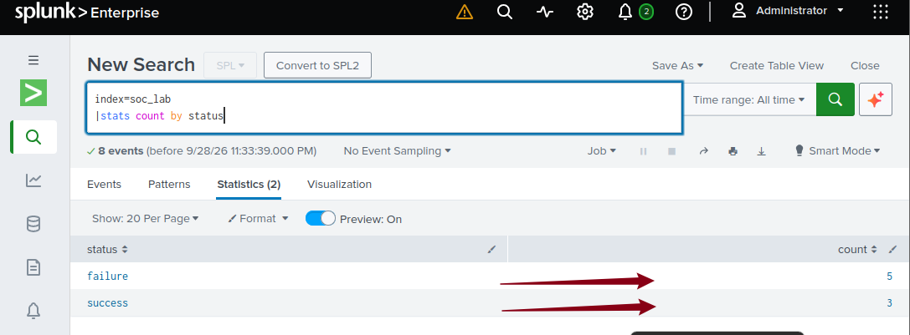


# 9. Investigating Failed Logins

After seeing that there were 5 failed login attempts, I investigated those events in more detail.


## 9.1 Viewing the failed login events

I searched only for events where the status was `failure`.

```spl
index=soc_lab status=failure
```

This removed the successful login events from the search and showed only failed attempts.

The result showed five failed SSH login attempts.

All five attempts came from:

```text
192.168.159.50
```

They targeted:

```text
admin
```

and used:

```text
ssh
```

failed login events
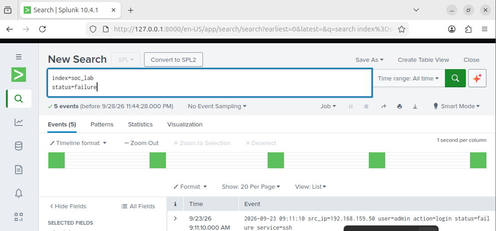

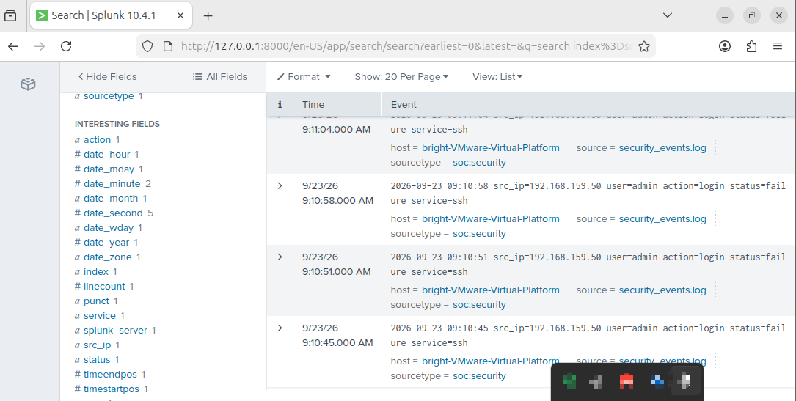


## 9.2 Finding the IP responsible for the failed logins

I then grouped the failed events by source IP.

```spl
index=soc_lab status=failure
| stats count by src_ip
```

This allowed me to see which IP address was responsible for the failed attempts.

The result showed:

```text
192.168.159.50 = 5 failed attempts
```

This meant that all five failed login attempts came from the same source IP.

failed login by IP
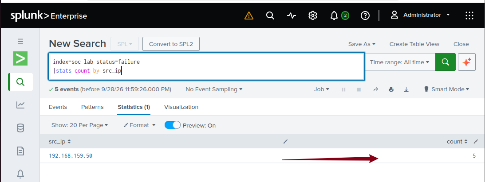

## 9.3 Finding the username targeted

Next, I grouped the failed events by username.

```spl
index=soc_lab status=failure
| stats count by user
```

The result showed:

```text
admin = 5
```

This means that all five failed login attempts were against the `admin` account.


failed login by user
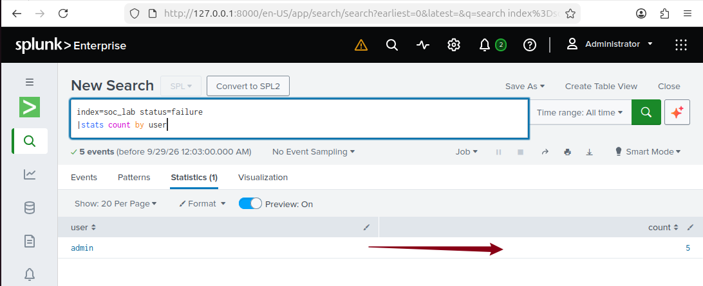


## 9.4 Looking at the failed login timeline

I sorted the failed login events by time.

```spl
index=soc_lab status=failure
| sort _time
```

Sorting by `_time` allowed me to see the order in which the failed login attempts happened.

The five failures occurred between:

```text
09:10:45
09:10:51
09:10:58
09:11:04
09:11:10
```

This showed that the failures happened close together in time.

failed login by timeline
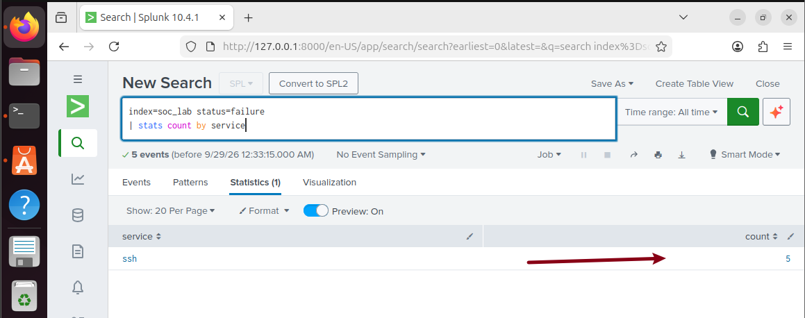


## 9.5 Checking the login service

I also wanted to know which service was being used for the failed attempts.

The results showed:

```text
ssh = 5
```

This means all five failed login attempts were SSH login attempts.

This is important because repeated failed SSH logins can be a useful pattern to investigate in a SOC environment.

Failed login summary
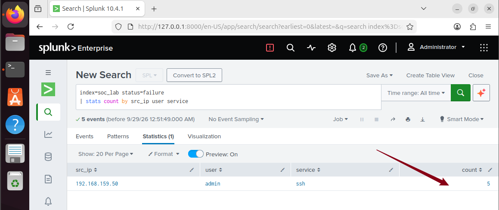


## 9.6 Comparing failed and successful logins by IP

I wanted to compare the successful and failed activity for each source IP.

I used:

```spl
index=soc_lab
| stats count by src_ip status
```

This groups the events by both IP address and login status.

The result showed:

* `192.168.159.20` → 1 success
* `192.168.159.25` → 1 success
* `192.168.159.50` → 5 failures
* `192.168.159.50` → 1 success

This was important because `192.168.159.50` had both repeated failures and a later successful login.

Failed vs successful IP
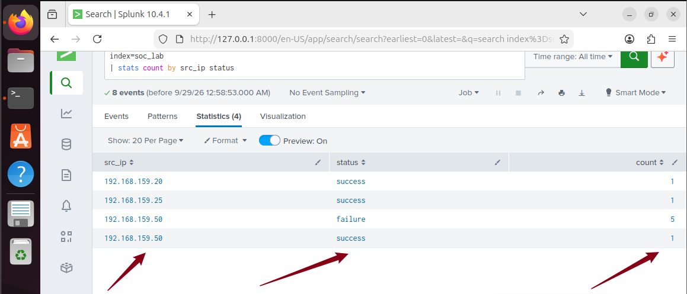


## 9.7 Checking for a successful login after the failures

I searched for a successful login from the same IP and user.

```spl
index=soc_lab status=success src_ip=192.168.159.50 user=admin
```

The result showed a successful login at:

```text
09:12:22
```

This happened after the five failed attempts from the same IP.

This does not by itself prove that an attack happened, but it is a suspicious pattern that is worth investigating.

Successful login after failure


## 9.8 Checking the successful login action

I added the action and service fields to the search.

The result showed:

```text
action = login
service = ssh
status = success
```

This confirmed that the successful event was an SSH login.

Successful login action
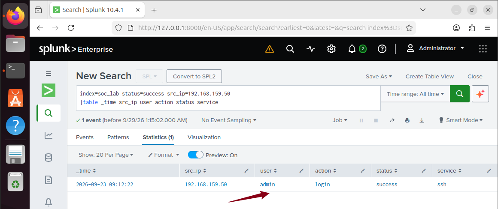


## 9.9 Checking successful logins by username

I checked which usernames had successful logins.

The result showed:

```text
admin = 2
bright = 1
```

This means the `admin` account had two successful login events in the dataset, while `bright` had one.

Successful login by user
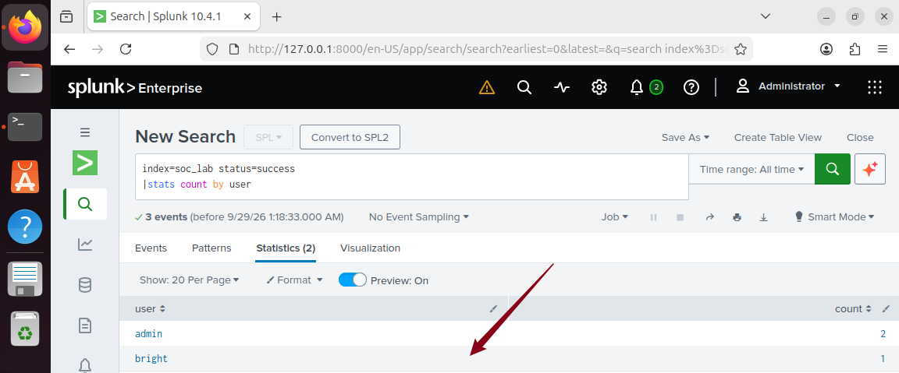


## 9.10 Checking successful admin logins

I then focused specifically on successful logins for the `admin` account.

The search showed two successful admin logins:

* `192.168.159.20` at 09:00:01
* `192.168.159.50` at 09:12:22

This helped me compare the different source IPs that successfully logged into the admin account.

Successful admin logins
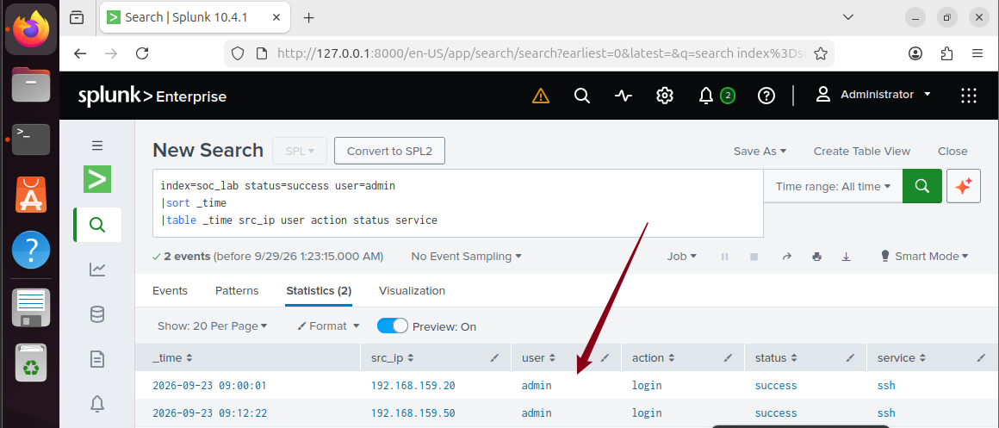


## 9.11 Building the activity timeline for the suspicious IP

I then looked at all events from:

```text
192.168.159.50
```

The timeline showed five failed SSH logins followed by one successful SSH login.

This gave me a clearer picture of the activity instead of looking at individual events separately.

Admin login activity timeline
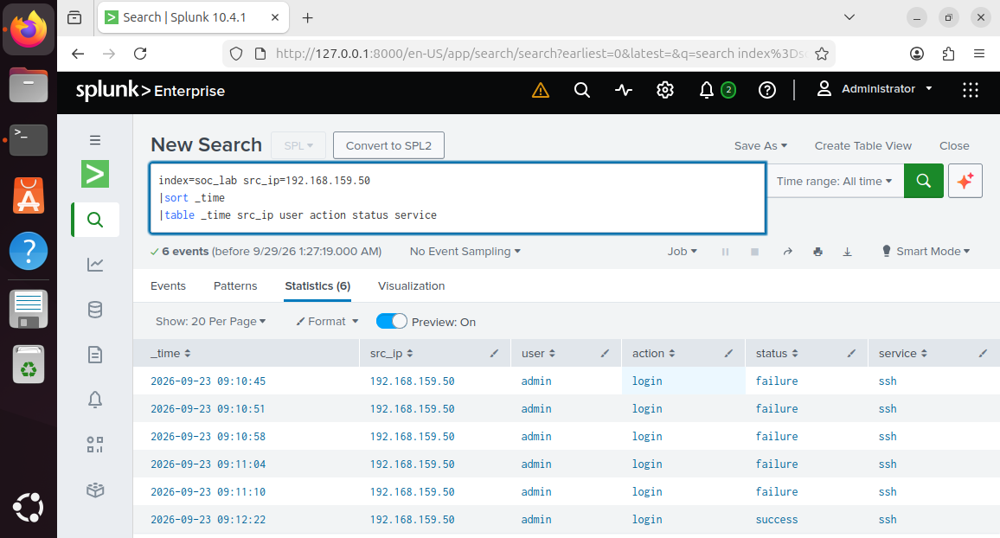


## 9.12 Checking successful admin logins by source IP

I grouped successful admin logins by source IP.

The result showed:

```text
192.168.159.20 = 1
192.168.159.50 = 1
```

This confirmed that two different IP addresses successfully logged into the admin account.

Admin successful logins by IP
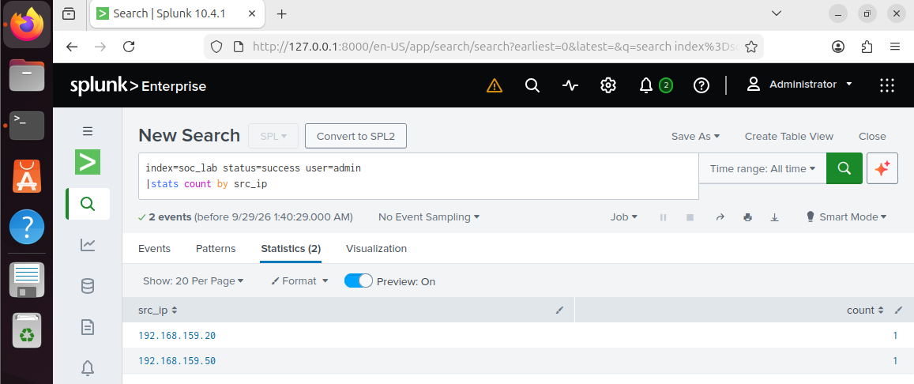


# 10. Detecting Suspicious Login Patterns

After investigating the failed and successful events, I created searches that could help identify repeated failed login activity.

## 10.1 Finding IP addresses with multiple failures

I used:

```spl
index=soc_lab status=failure
| stats count by src_ip
| where count >= 3
```

The `stats` command counts the failures for each IP.

The `where count >= 3` part tells Splunk to show only IP addresses with three or more failed attempts.

The result was:

```text
192.168.159.50 = 5
```

This identified `192.168.159.50` as an IP with repeated failed login activity.

Suspicious failed login IPS
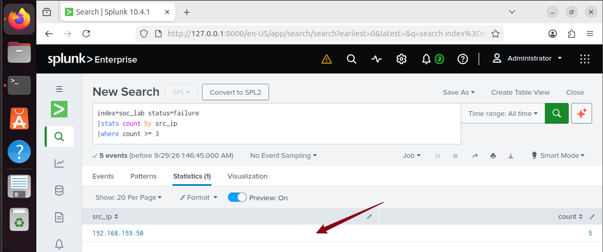


## 10.2 Finding users with multiple failures

I used:

```spl
index=soc_lab status=failure
| stats count by user
| where count >= 3
```

This groups the failures by username and displays usernames with at least three failures.

The result was:

```text
admin = 5
```

This showed that the `admin` account received five failed login attempts.

Suspicious failed login, users
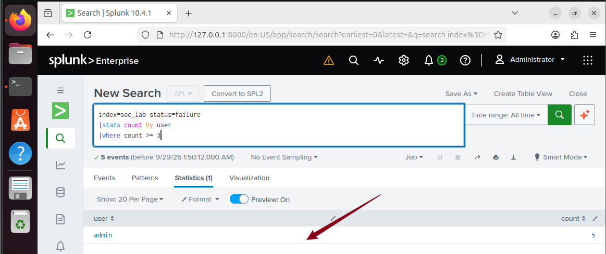


## 10.3 Finding the IP and username combination

I wanted to connect the source IP and username together.

```spl
index=soc_lab status=failure
| stats count by src_ip user
| where count >= 3
```

The result showed:

```text
192.168.159.50
admin
5 failures
```

This was more useful than looking at the IP and username separately because it showed exactly which account was being targeted from the IP.

Suspicious IP user combination
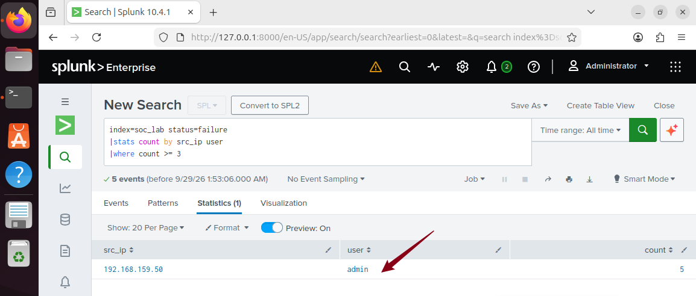


## 10.4 Adding the SSH service

I added the service to the search.

```spl
index=soc_lab status=failure
| stats count by src_ip user service
| where count >= 3
```

The result showed:

```text
192.168.159.50
admin
ssh
5 failures
```

This gave me the full pattern:

**One IP → one user → one service → repeated failures.**

Suspicious SSH login pattern
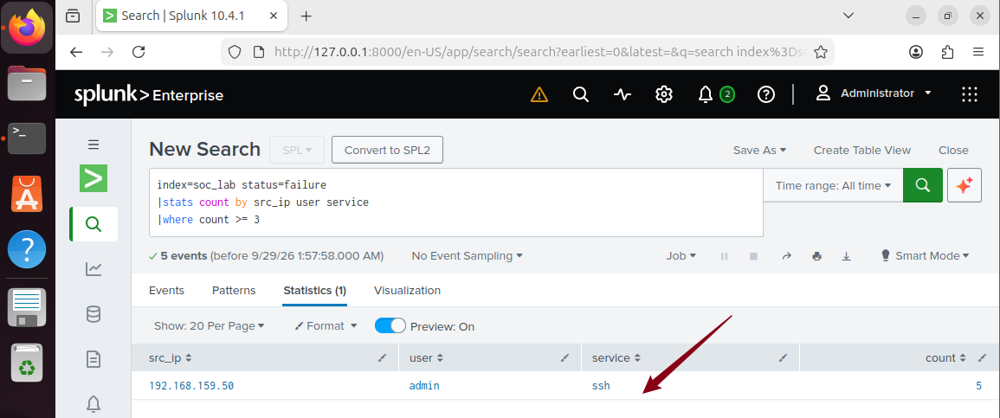


## 10.5 Checking the successful login

I then searched specifically for the successful login from the same IP and username.

```spl
index=soc_lab status=success src_ip=192.168.159.50 user=admin
| table _time src_ip user action status service
```

The result showed a successful SSH login at:

```text
09:12:22
```

This was important because it occurred after the repeated failures.

Successful login after failures
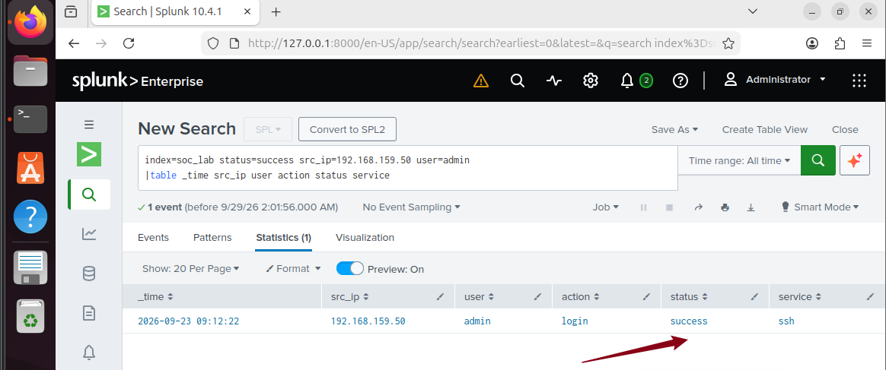


## 10.6 Calculating the time between login attempts

I wanted to know how quickly the login attempts were happening.

I used:

```spl
index=soc_lab src_ip=192.168.159.50 user=admin
| sort _time
| streamstats current=f window=1 last(_time) as previous_time
| eval time_difference=_time-previous_time
| table _time user status service time_difference
```

The important part here is:

```text
streamstats
```

It allows Splunk to look at the previous event.

Then:

```text
time_difference=_time-previous_time
```

calculates the number of seconds between the current event and the previous event.

The failed attempts were only a few seconds apart:

* 6 seconds
* 7 seconds
* 6 seconds
* 6 seconds

The later successful login happened 72 seconds after the final failure.

Login attempt time difference
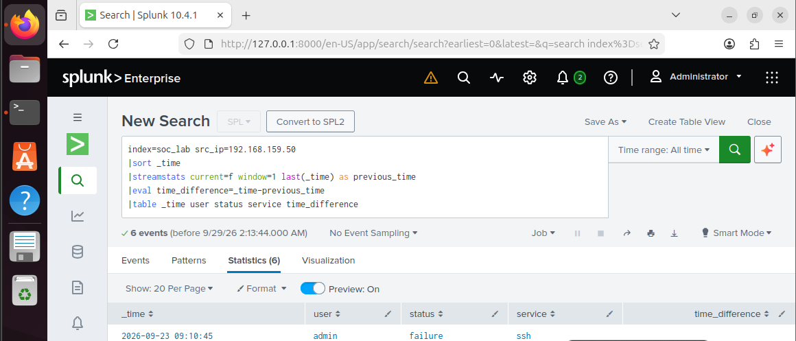

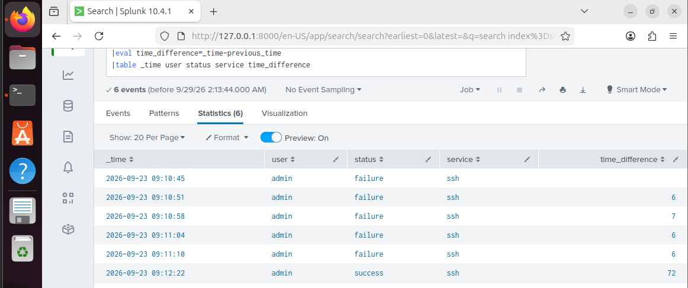


## 10.7 Creating a detection summary

I created a cleaner summary of the repeated failures.

```spl
index=soc_lab status=failure
| stats count as failed_attempts by src_ip user service
| where failed_attempts >= 3
| sort - failed_attempts
```

The result showed:

```text
src_ip: 192.168.159.50
user: admin
service: ssh
failed_attempts: 5
```

This is easier for a SOC analyst to read because it summarizes the important information in one row.

Soc failed login detection summary
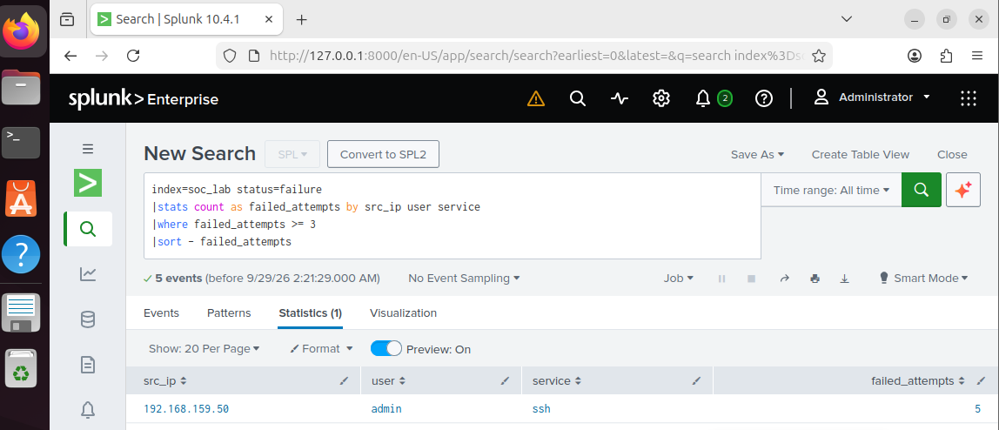


## 10.8 Finding the first and last failed attempt

I wanted to know exactly when the repeated failed login activity started and ended.

I used:

```spl
index=soc_lab status=failure
| stats count as failed_attempts earliest(_time) as first_failure latest(_time) as last_failure by src_ip user service
| where failed_attempts >= 3
```

The result showed:

```text
First failure: 09:10:45
Last failure: 09:11:10
```

This gave me the time range of the repeated login activity.

Failed login time range
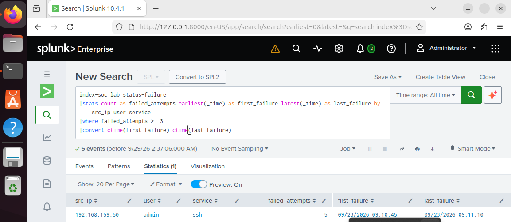


## 10.9 Calculating the duration

I calculated how long the five failed attempts lasted.

```spl
| eval duration=last_failure-first_failure
```

This subtracts the first failure time from the last failure time.

The result was:

```text
25 seconds
```

So the five failed SSH login attempts happened within a 25-second period.

Failed login duration
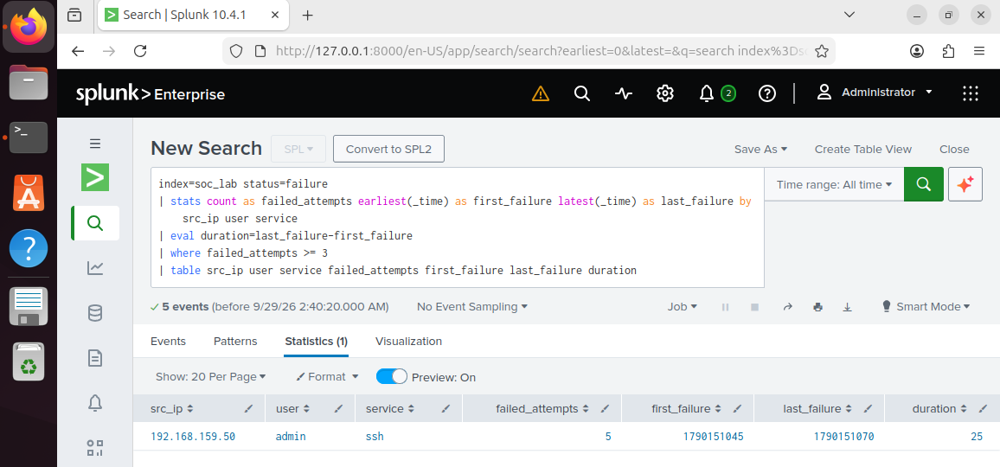


## 10.10 Creating a clean detection result

I combined the important information into one search.

The result showed:

```text
IP: 192.168.159.50
User: admin
Service: ssh
Failed attempts: 5
First failure: 09:10:45
Last failure: 09:11:10
Duration: 25 seconds
```

This was a useful detection summary because it gives an analyst the main information without needing to inspect every event individually.

Clean failed login detection
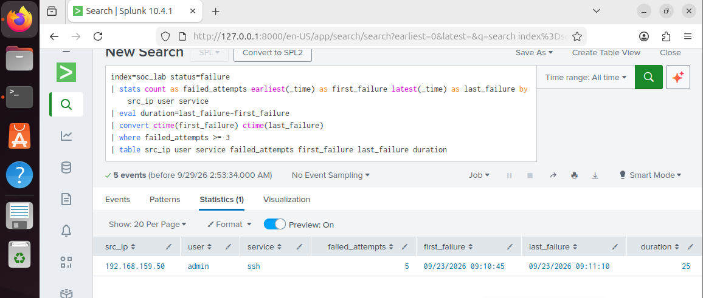


## 10.11 Comparing failed and successful attempts

I used:

```spl
index=soc_lab src_ip=192.168.159.50 user=admin
| stats count(eval(status="failure")) as failed_attempts count(eval(status="success")) as successful_attempts by src_ip user
```

This counted the failures and successes separately.

The result showed:

```text
Failed attempts: 5
Successful attempts: 1
```

This showed that the same IP and username combination had both repeated failures and a later success.

Failed and successful login summary
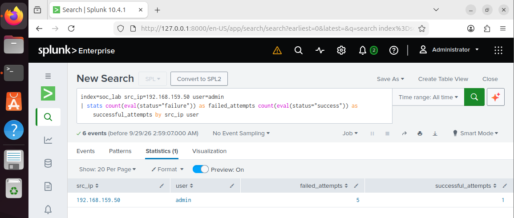


## 10.12 Calculating the gap between the last failure and success

I wanted to know exactly how long it took for the successful login to happen after the last failed attempt.

I used:

```spl
index=soc_lab src_ip=192.168.159.50 user=admin
| stats latest(eval(if(status="success", _time, null()))) as success_time latest(eval(if(status="failure", _time, null()))) as last_failure by src_ip user
| eval time_difference=success_time-last_failure
| convert ctime(success_time) ctime(last_failure)
| table src_ip user last_failure success_time time_difference
```

The important part is:

```text
success_time-last_failure
```

This calculates the time between the last failure and the successful login.

The result was:

```text
Last failure: 09:11:10
Successful login: 09:12:22
Difference: 72 seconds.
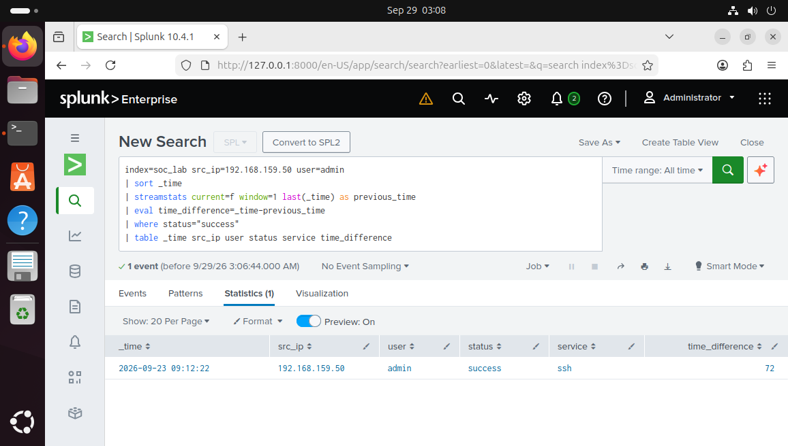


Creating the final login detection

Finally, I created a simple detection condition.

```spl
index=soc_lab src_ip=192.168.159.50 user=admin
| stats count(eval(status="failure")) as failed_attempts count(eval(status="success")) as successful_attempts by src_ip user service
| eval result=if(failed_attempts>=3 AND successful_attempts>=1,"Repeated failures followed by success","Review")
| table src_ip user service failed_attempts successful_attempts result
```

The search checks two conditions:

1. There must be at least 3 failed attempts.
2. There must be at least 1 successful attempt.

The result was:

```text
Failed attempts: 5
Successful attempts: 1
Result: Repeated failures followed by success
```

This gives a simple SOC detection for the pattern found in the lab.

It should be noted that this result identifies a suspicious pattern. It does not by itself prove that a real attacker was responsible.

Login detection summary
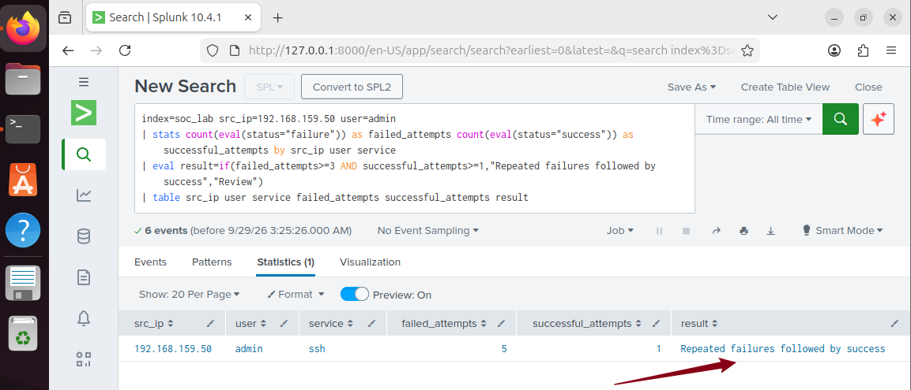


# 11. Building an Attack Timeline

After detecting the suspicious pattern, I wanted to see the complete sequence of events in chronological order.

## 11.1 Creating the timeline

I used:

```spl
index=soc_lab
| sort _time
| table _time src_ip user status service action
```

This sorts all events according to their time.

The timeline showed:

```text
09:00:01  192.168.159.20  admin   success
09:05:12  192.168.159.25  bright  success
09:10:45  192.168.159.50  admin   failure
09:10:51  192.168.159.50  admin   failure
09:10:58  192.168.159.50  admin   failure
09:11:04  192.168.159.50  admin   failure
09:11:10  192.168.159.50  admin   failure
09:12:22  192.168.159.50  admin   success
```

This made the complete order of the login activity easier to understand.

Attack timeline
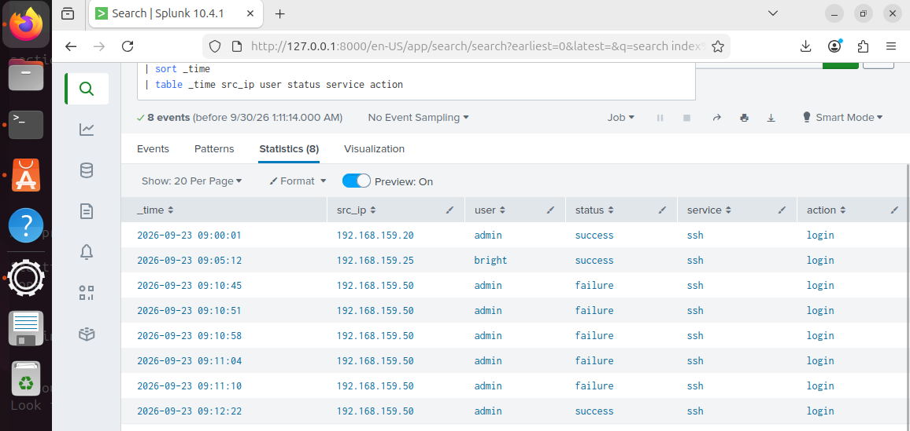


## 11.2 Adding time gaps to the timeline

I used `streamstats` again to calculate the time between each event.

```spl
index=soc_lab src_ip=192.168.159.50 user=admin
| sort _time
| streamstats current=f window=1 last(_time) as previous_time
| eval time_difference=_time-previous_time
| table _time src_ip user status service time_difference
```

The results showed:

```text
6 seconds
7 seconds
6 seconds
6 seconds
72 seconds
```

The first four gaps were between the repeated failed login attempts.

The 72-second gap was between the final failure and the successful login.

Attack timeline time gaps
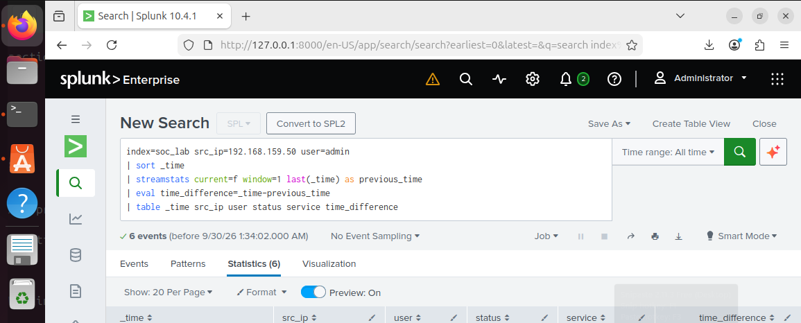
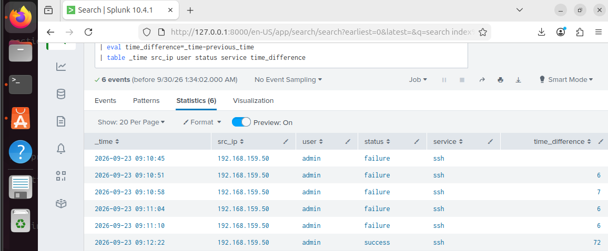


## 11.3 Making the timeline easier to understand

I created a simple event description using:

```spl
eval event=if(status="failure","Failed SSH login","Successful SSH login")
```

This changes the technical status values into easier descriptions.

The result showed five:

```text
Failed SSH login
```

events followed by:

```text
Successful SSH login
```

This made the sequence easier to read as an investigation timeline.

Attack timeline summary
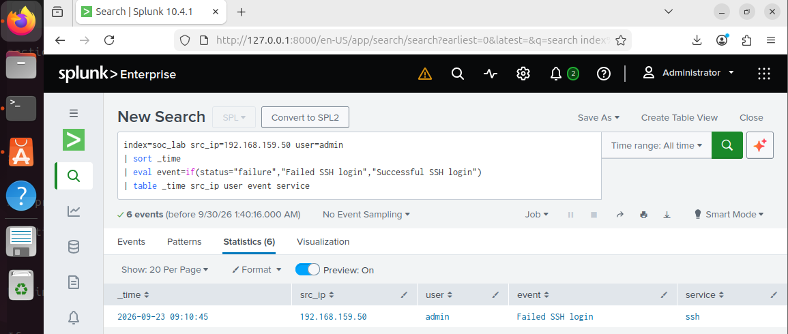
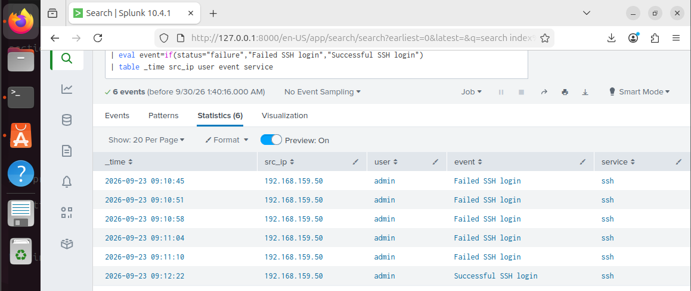


# 12. Detecting a Brute-Force Pattern

The next step was to create a search that could identify repeated failed login attempts.

In this project, I used the term **brute-force pattern** because the dataset contains repeated login failures from the same source.

This does not prove that a real brute-force attack happened. It shows a pattern that a SOC analyst would investigate.


## 12.1 Detecting repeated failures

I used:

```spl
index=soc_lab status=failure
| stats count as failed_attempts by src_ip user
| where failed_attempts >= 3
| sort - failed_attempts
```

The search counts failed attempts for each IP and username combination.

I used:

```text
where failed_attempts >= 3
```

to show only combinations with three or more failures.

The result was:

```text
192.168.159.50
admin
5 failed attempts
```

Bruteforce detection
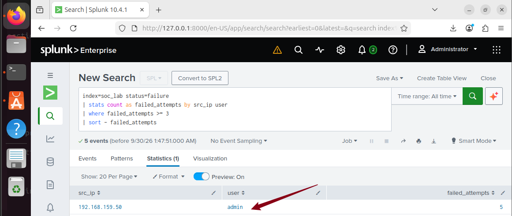


## 12.2 Including the service

I then included the service in the detection.

```spl
index=soc_lab status=failure
| stats count as failed_attempts by src_ip user service
| where failed_attempts >= 3
| sort - failed_attempts
```

The result showed:

```text
IP: 192.168.159.50
User: admin
Service: ssh
Failed attempts: 5
```

This gave me more context about the type of login being targeted.

Index soc lab-status =failure


## 12.3 Calculating the brute-force time window

I wanted to know how long the five failed attempts lasted.

I used:

```spl
index=soc_lab status=failure src_ip=192.168.159.50 user=admin
| stats count as failed_attempts earliest(_time) as first_failure latest(_time) as last_failure
| eval duration=last_failure-first_failure
| convert ctime(first_failure) ctime(last_failure)
| table failed_attempts first_failure last_failure duration
```

The result showed:

```text
Failed attempts: 5
First failure: 09:10:45
Last failure: 09:11:10
Duration: 25 seconds
```

This means five failed login attempts occurred within 25 seconds.

Bruteforce time window
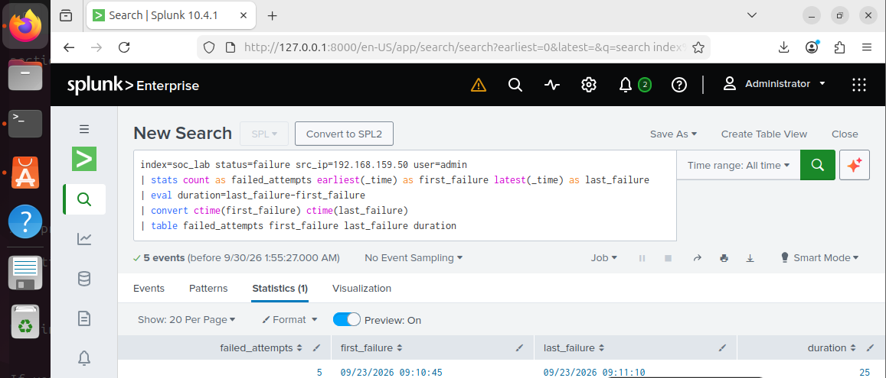


# 13. Final Brute-Force Detection

I combined the important information into one final detection search.

```spl
index=soc_lab status=failure
| stats count as failed_attempts earliest(_time) as first_failure latest(_time) as last_failure by src_ip user service
| where failed_attempts >= 3
| eval duration=last_failure-first_failure
| convert ctime(first_failure) ctime(last_failure)
| table src_ip user service failed_attempts first_failure last_failure duration
| sort - failed_attempts
```

The final result showed:

```text
Source IP: 192.168.159.50
User: admin
Service: ssh
Failed attempts: 5
First failure: 09:10:45
Last failure: 09:11:10
Duration: 25 seconds
```

This is the main brute-force-pattern detection from the project.

The important thing I learned here is that a SOC analyst does not only look at the number of failed logins. They also look at:

* Where the attempts came from
* Which account was targeted
* Which service was involved
* How many attempts happened
* When the attempts started
* When they stopped
* How quickly the attempts occurred

Final bruteforce detection
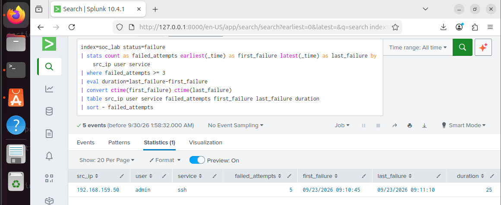


# 14. Checking the Dataset for Web Attacks

I also checked whether the dataset contained web-related events.

I searched the available services and actions.

The service results showed:

```text
ssh = 8
```

The action results showed:

```text
login = 8
```

This means all eight events in this dataset were SSH login events.

There were no HTTP or web application events available in the current dataset.

Because of this, I did not create fake web attack results.

This is important because a SOC investigation should be based on the data that actually exists.


# 15. Creating the SOC Dashboard

After completing the investigations, I created a Splunk dashboard to display some of the important results in one place.

The dashboard was named:

```text
SOC Login Monitoring Dashboard
```

The purpose of the dashboard is to make the important login activity easier to monitor without running every search separately.


## 15.1 Repeated Failed SSH Logins panel

The first panel used:

```spl
index=soc_lab status=failure
| stats count as failed_attempts by src_ip user service
| where failed_attempts >= 3
| sort - failed_attempts
```

This panel shows IP addresses, usernames, and services with repeated failed login attempts.

The result identifies:

```text
192.168.159.50
admin
ssh
5 failed attempts
```

This makes the suspicious login pattern easy to see on the dashboard.

Dashboard repeated failed logins search
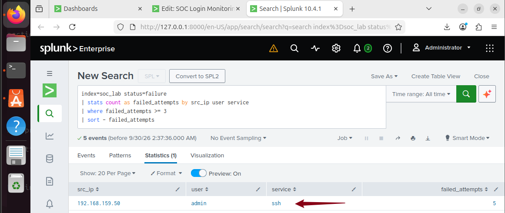


## 15.2 Login Status Summary panel

The second panel used:

```spl
index=soc_lab
| stats count by status
| sort - count
```

This counts all events according to their status.

The result was:

```text
Failure = 5
Success = 3
```

This gives a quick overview of the login activity in the dataset.

Dashboard login status summary


## 15.3 Failed Login Timeline panel

The third panel used:

```spl
index=soc_lab status=failure
| sort _time
| table _time src_ip user service action
```

This displays the failed login events in chronological order.

It makes it easier to see when the failed attempts happened and which IP and user were involved.

Dashboard failed login timeline


## 15.4 Successful Logins by Source IP panel

The fourth panel used:

```spl
index=soc_lab status=success
| stats count by src_ip
| sort - count
```

This groups successful logins according to their source IP address.

The result showed:

```text
192.168.159.20 = 1
192.168.159.25 = 1
192.168.159.50 = 1
```

This allows an analyst to quickly see which IP addresses generated successful login activity.

Dashboard successful logins by source IP


# 16. Final Incident Investigation

For the final investigation, I focused on:

```text
192.168.159.50
```

and:

```text
admin
```

The investigation showed:

1. Five failed SSH login attempts occurred.
2. The attempts came from `192.168.159.50`.
3. The targeted username was `admin`.
4. The failures happened between `09:10:45` and `09:11:10`.
5. The five failures occurred within 25 seconds.
6. A successful SSH login happened at `09:12:22`.
7. The successful login happened 72 seconds after the last failed attempt.

The important relationship was:

```text
5 failed SSH logins
        ↓
25-second failure window
        ↓
last failure at 09:11:10
        ↓
72 seconds
        ↓
successful SSH login at 09:12:22
```

I used this information to identify a suspicious repeated-login pattern.

Again, this lab result should not be presented as proof of a real attack. It is a controlled lab dataset used to practice SOC investigation and detection.

Final incident time gap


# 17. Final Findings

The main finding from this investigation was a repeated SSH login pattern from:

```text
192.168.159.50
```

against:

```text
admin
```

The IP made:

```text
5 failed SSH login attempts
```

within:

```text
25 seconds
```

A successful SSH login then occurred:

```text
72 seconds after the final failure
```

This pattern was flagged for investigation because repeated authentication failures followed by a successful login can be useful to investigate in a SOC environment.

The lab does not prove that the activity was performed by a real attacker. It demonstrates how Splunk can be used to identify and investigate this type of pattern.


# 18. What I Learned

During this project, I learned how to:

* Start and check the Splunk service.
* Open and use Splunk Web.
* Create and use a Splunk index.
* Upload security logs.
* Search logs using SPL.
* Filter failed and successful login events.
* Group events by IP address and username.
* Investigate SSH login activity.
* Calculate the time between events.
* Create a login activity timeline.
* Detect repeated failed login attempts.
* Investigate a brute-force pattern.
* Compare failed logins with successful logins.
* Build a simple Splunk dashboard.
* Summarize findings from security logs.


# 19. Security Relevance

Authentication logs are important in security monitoring because they can help analysts identify unusual login activity.

Repeated failed login attempts can be a sign that an account or service needs further investigation.

In a real SOC environment, an analyst could use similar searches to investigate:

* Repeated login failures
* Suspicious source IP addresses
* Targeted usernames
* Successful logins after multiple failures
* Unusual login times
* Possible brute-force activity

Splunk can help an analyst quickly search large amounts of security data and identify patterns that may need further investigation.


# 20. Tools Used

* Splunk 10.4.1
* Ubuntu Linux
* SPL (Search Processing Language)
* VMware Workstation
* Security log dataset


# 21. Conclusion

This project gave me practical experience using Splunk for basic SOC monitoring and investigation.

I started by uploading security logs into Splunk and learning basic searches. I then investigated failed SSH logins, identified the source IP and targeted username, calculated the time between login attempts, detected a repeated failed-login pattern, and created a dashboard to monitor the results.

The main pattern found in the lab was five failed SSH login attempts from `192.168.159.50` against the `admin` account within 25 seconds, followed by a successful login 72 seconds after the last failure.

This project helped me understand how Splunk can be used to search security logs, identify suspicious patterns, and support SOC investigations.
